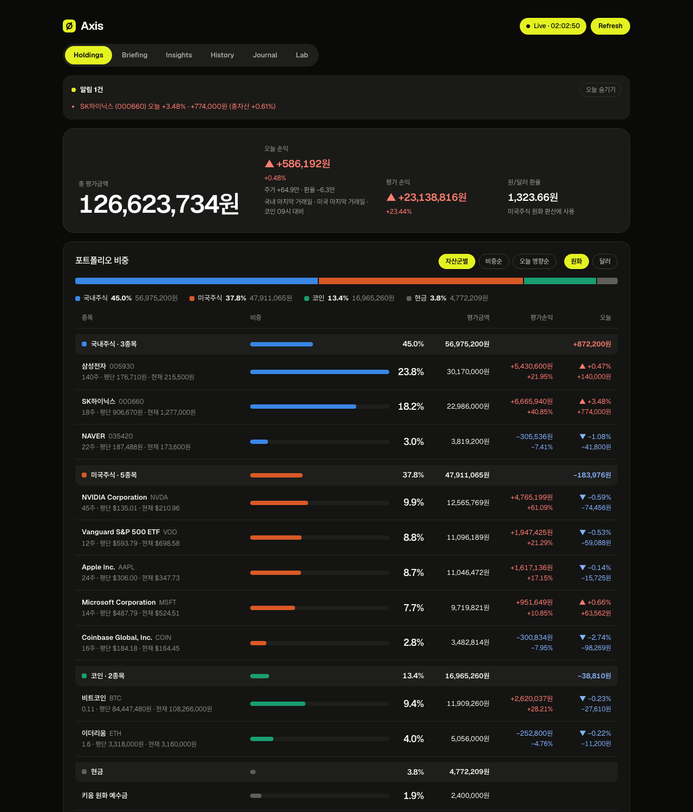
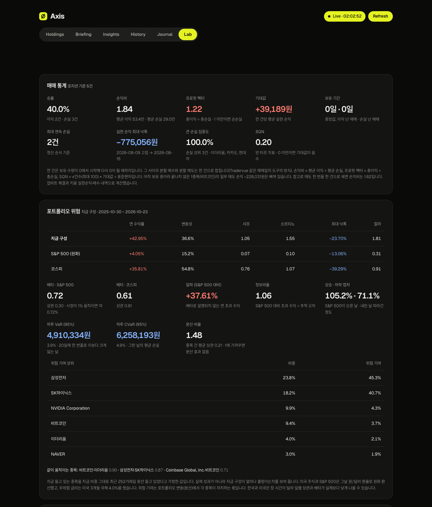
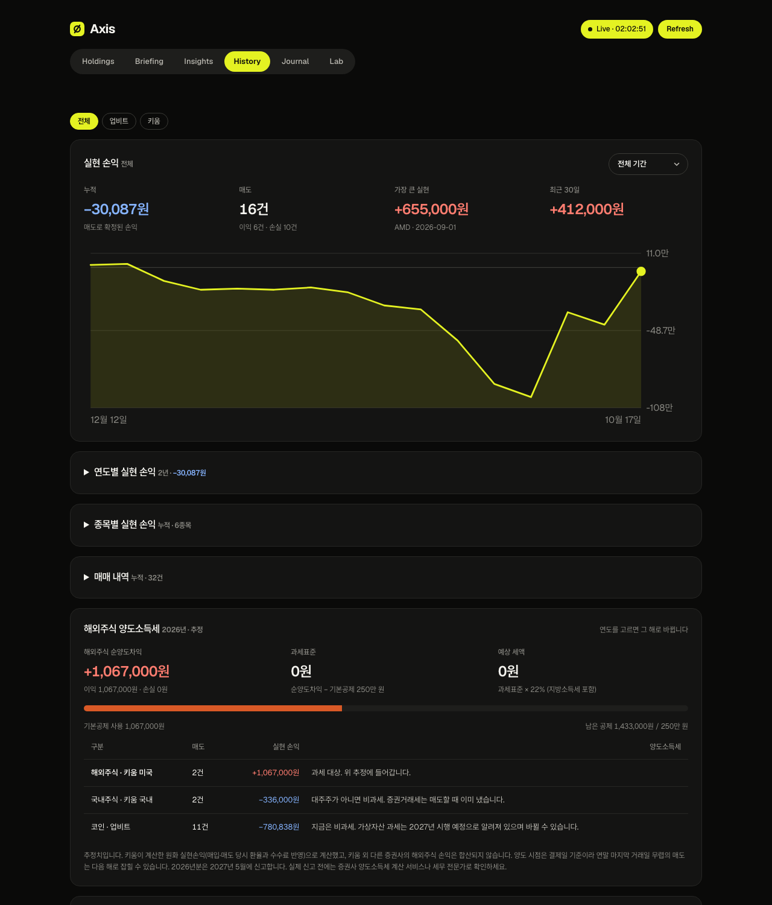
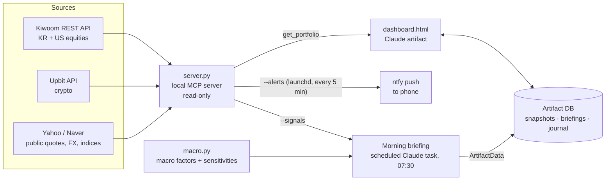

# Axis

**A personal multi-asset risk desk, built with AI coding tools.** Axis brings Korean equities, US equities and crypto from three brokerage APIs into one live dashboard. On top of that it runs a risk-monitoring layer modeled on how a fund's risk team watches a book: risk contribution, correlation clustering, drawdown, VaR breaches and crypto–equity coupling.

**▶ Live demo: [jaehyeongjakechoi.github.io/axis](https://jaehyeongjakechoi.github.io/axis/)** (fictional portfolio, runs in the browser)



> All screenshots use the fictional demo portfolio in [`demo/`](demo/). No real balances are published in this repository.

---

## What it does

| Tab | Question it answers |
|---|---|
| **Holdings** | What do I own right now, across all accounts, in KRW and USD? Live balances every 10 s, with today's P&L split into price move vs. FX effect |
| **Briefing** | What happened overnight that matters *to this portfolio*? An AI-written morning brief at 07:30 KST, with every figure computed by code (`macro.py`) rather than copied from articles |
| **Insights** | Am I beating the market? Portfolio vs. S&P 500 and KOSPI over the same window |
| **History** | Realized P&L by year, estimated US capital-gains tax, dividend and interest income, external cash flows |
| **Journal** | Why did I make this trade? New fills are detected automatically and open a journal entry |
| **Lab** | What kind of investor am I, and where is the risk? Trade statistics (win rate, profit factor, SQN) plus full portfolio risk analytics |



<details><summary>History tab: realized P&L curve (demo data)</summary>



</details>

## Risk signals

Five signals are computed on every full refresh. A push notification goes out only when a signal **changes state** (normal → caution → warning, or back), and the recovery threshold has a small buffer so a signal sitting near its threshold doesn't keep firing alerts. Each alert is one line stating the fact and one line asking a review question. Axis never tells you to buy or sell.

| Signal | What is measured | Caution / Warning | Basis |
|---|---|---|---|
| **Risk concentration** | One position's share of total portfolio variance (Euler risk contribution), and its risk ÷ weight ratio | 15% / 25%, or 1.5× / 2.0× weight | Design choice; the equal share for 17 names would be ~5.9% |
| **Cohesion** | Average 60-day pairwise correlation among equity positions ≥ 5% weight | 0.35 / 0.50 | Design choice |
| **Drawdown** | Distance from peak, absolute and relative to the trailing 1-year max drawdown | −15% / −25%, or 50% / 80% of 1y MDD | Design choice; monitor only, no stop-loss (Kaminski & Lo) |
| **Daily loss** | Today's move as a multiple of 1-day VaR95, plus VaR breaches in the last 20 sessions | 1.5× / 2.0×, or 3 / 5 breaches | **Math**: if VaR95 is correctly calibrated, P(≥3 of 20) ≈ 7.5% and P(≥5 of 20) ≈ 0.3% (binomial) |
| **Crypto–equity coupling** | 60-day BTC vs. S&P 500 correlation, and BTC's risk contribution vs. its weight | 0.30 / 0.50 | Literature reference: IMF (2022) measured ~0.36 post-2020 |

Every threshold carries a tag: **[Literature]**, **[Design]** or **[Math]**. That way it's always clear which numbers come from research and which are my own choices. The thresholds come out of a literature review I ran first ([`docs/research/risk-contribution.md`](docs/research/risk-contribution.md)), which was then turned into a written rule set ([`docs/operating-principles.md`](docs/operating-principles.md)).

## Architecture



- **`server.py`** (~2,800 lines, Python standard library only): an MCP server that the Claude desktop app launches. It pulls balances, fills, realized P&L, deposits/withdrawals and dividends from Kiwoom and Upbit, then fills in prices, FX and benchmarks from public sources. It also computes risk (volatility, Sharpe/Sortino, beta, alpha, VaR/CVaR, risk contribution, correlation). **Read-only by design:** no order endpoint exists anywhere in the code.
- **`dashboard.html`** (~2,100 lines, one self-contained file): polls a lightweight quotes view (~12 KB) every 10 s and fetches the full payload (~800 KB) only on load, on refresh, every 5 minutes, or when a quantity change signals a trade. Polling pauses while the tab is hidden.
- **`macro.py`**: market dashboard for the brief (indices, rates in bp, FX, commodities, crypto). It also computes portfolio sensitivity to each macro factor, as a regression of portfolio returns on factor returns.
- **[`prompts/morning-briefing.md`](prompts/morning-briefing.md)**: the full instruction set for the scheduled AI agent that writes the daily brief. The agent is told to take numbers only from script output and never from news text, and to report risk signals exactly as the system judged them.
- **Engineering details** handled along the way: Kiwoom token refresh and rate-limit retry; trades that execute today but settle later (shown as *pending*); USD/KRW on the trade date for US cost basis; moving-average cost basis for crypto; Korean market holidays; and deduplicating alerts across restarts.

## How I used AI to build this

I built Axis with Claude Code as the engineer and kept the product decisions, the risk methodology and the review of every change to myself.

- **Iterating feature by feature.** Axis went from a first version to the current system in about two weeks (Oct 4–15, 2026), across more than 25 named iterations. Each one was snapshotted before the change. See the build log below.
- **Research before rules.** Before writing any risk-signal code, I ran an AI-assisted literature review on risk contribution, retail investor behavior, fund concentration limits (UCITS, Korean public-fund rules) and BTC–equity correlation. The rules were written down and tagged by evidence strength before they were implemented.
- **Keeping the LLM's numbers honest.** Numbers are produced by code (`macro.py`, `server.py --signals`), and the LLM's job is to explain them. That is the most important design rule I learned from this project.
- **Keeping the AI away from the money.** The portfolio server cannot place orders. API keys never leave the machine, and the `--check` and `--signals` outputs never print amounts.

### Build log

| Date (2026) | Milestone |
|---|---|
| Oct 4–5 | Read-only MCP server for Kiwoom + Upbit; live dashboard; yearly realized P&L; dividend calendar; ntfy push alerts; price-target alerts; deduplication |
| Oct 7 | Auto-journal on new fills; pending-trade detection; trade statistics; portfolio risk analytics; corporate actions (rights issues); complementary-asset suggestions |
| Oct 9 | Macro factor model for the morning brief; Korean market holiday calendar |
| Oct 10 | Brief index/archive; lightweight 10 s quotes polling (12 KB vs. 800 KB); QA pass |
| Oct 15 | Literature review → operating principles → five risk signals with state-transition alerts and hysteresis |

## Run the demo (no accounts needed)

```bash
git clone https://github.com/JaehyeongJakeChoi/axis.git && cd axis
python3 -m http.server 8000
# open http://localhost:8000/dashboard.html
```

The dashboard detects that it is not running inside the Claude app and loads [`demo/sample-portfolio.json`](demo/sample-portfolio.json). To rebuild that file from live public market data using the **real server pipeline** (only the broker calls are swapped for a fictional portfolio):

```bash
python3 demo/demo.py --dump > demo/sample-portfolio.json
python3 demo/demo.py --signals      # the five risk signals, percentages only
```

## Run with real accounts

1. **Upbit**: issue an Open API key with *view assets* permission only, and allowlist your IP.
2. **Kiwoom**: apply for REST API access at openapi.kiwoom.com, issue a production app key, and register your IP.
3. Copy `api-keys.example.txt` to `api-keys.txt` and fill it in. `api-keys.txt` is git-ignored.
4. `python3 server.py --check` confirms the connection. It prints position counts and field names, never amounts.
5. Register `server.py` as an MCP server named `portfolio` in the Claude desktop app, then open `dashboard.html` as an artifact.
6. Optional: run `python3 server.py --alerts` every 5 minutes (launchd/cron) for phone push via [ntfy](https://ntfy.sh).

## Repository layout

```
server.py                  MCP server: balances, ledger, risk, signals, alerts
dashboard.html             single-file dashboard (Claude artifact)
macro.py                   macro factors + portfolio sensitivity for the brief
prompts/morning-briefing.md  instructions for the scheduled briefing agent (Korean)
demo/                      fictional portfolio + generated sample payload
docs/research/             literature reviews: risk contribution, BTC valuation (Korean)
docs/operating-principles.md  risk rules with evidence tags (Korean)
docs/Axis-brochure.pdf     two-page product brochure (example figures)
```

The code comments and research notes are in Korean, because I wrote them for myself first.

## Disclaimer

Personal project, not investment advice. The software is read-only toward brokerage accounts and cannot place orders.
