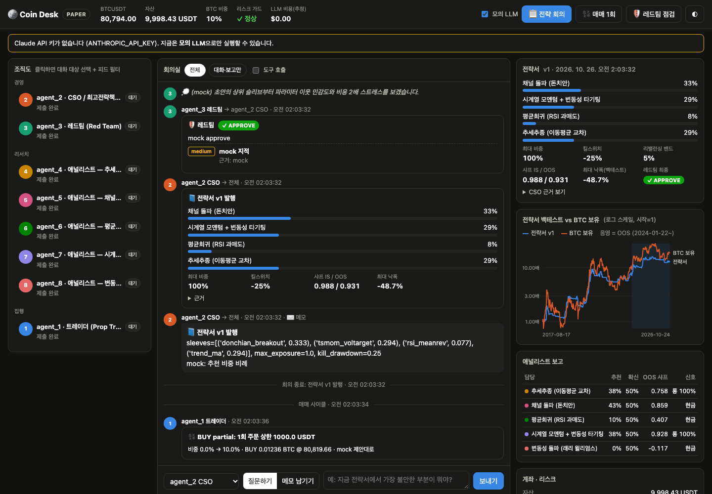

# Coin Desk: an 8-agent BTC trading desk

A multi-agent system that trades BTC/USDT spot (long-only) on Binance. The agents run on the Claude API (`claude-opus-5-5`) and are organized like a small hedge fund desk. The LLMs research and argue; deterministic code computes the numbers and enforces the risk limits.

[한국어 README](README.ko.md)



## Org chart

| Agent | Role | Responsibility |
|---|---|---|
| agent_1 | Prop trader | Reviews the engine's target exposure and executes. May only execute **at or below** the proposal and has no discretion to increase risk |
| agent_2 | CSO | Synthesizes the five analyst reports into a StrategyBook and responds to red-team critique |
| agent_3 | Red team | Critiques the book with evidence (approve / revise / reject), monitors it while it is live, and can request an emergency review |
| agent_4 | Analyst | Trend following, moving-average crossover (`trend_ma`) |
| agent_5 | Analyst | Channel breakout, Donchian (`donchian_breakout`) |
| agent_6 | Analyst | Mean reversion, RSI oversold (`rsi_meanrev`) |
| agent_7 | Analyst | Time-series momentum with volatility targeting (`tsmom_voltarget`) |
| agent_8 | Analyst | Volatility breakout, Larry Williams (`vol_breakout`) |

Agents talk to each other through `ask_agent` (a synchronous question: the other agent checks with its own tools and answers) and `send_message` / `read_inbox` (asynchronous memos). Every exchange is logged to `state/messages.jsonl` and `state/conversations.jsonl`.

## Flow

```
Research meeting (every 24 h by default)
  agent_4–8 in parallel: parameter sweep → robustness check → submit_report
                         (the system re-runs the backtest and attaches the numbers)
  agent_2: synthesize reports + portfolio backtest → StrategyBook draft
  agent_3: review → if "revise", agent_2 revises (2 rounds by default)
  final "reject" → book is published with max_exposure cut by 50%

Trading cycle (every 60 min by default)
  engine: sleeve signals × weights → target exposure → risk guards
  agent_1: review → execute_rebalance / hold

Red-team monitoring (every 12 h) → escalate triggers an emergency research meeting
```

## LLMs cannot make up numbers

- Every performance figure is computed by a deterministic backtest engine (`backtest.py`). When an agent submits a report or a strategy book, the system re-runs the backtest and attaches the results itself.
- The last 30% of the history is out-of-sample. Parameter sweeps show in-sample and out-of-sample results side by side.
- Costs are modeled at 0.1% fee and 0.05% slippage, each way.

## Hard limits the LLM cannot cross (`config.py`)

- Spot long-only, maximum exposure 100%, no leverage.
- **Kill switch:** if drawdown from peak reaches the book's `kill_drawdown` (capped at 30%), the position is fully liquidated without consulting any LLM. No new buys are allowed until a new book is published.
- If the daily loss exceeds 5%, exposure cannot increase for the rest of the day.
- Per-order cap of 1,000 USDT (`COIN_DESK_MAX_ORDER`). Large rebalances are filled over several cycles.
- Differences inside the rebalancing band are not traded.

## Run

```bash
cd coin-desk
uv sync
export ANTHROPIC_API_KEY=...        # not needed with --mock
```

```bash
uv run python -m coin_desk --mock research   # whole pipeline end to end, no API cost
uv run python -m coin_desk research          # real research meeting → publish a book
uv run python -m coin_desk trade             # one trading cycle (paper by default)
uv run python -m coin_desk run               # continuous loop
uv run python -m coin_desk status            # book, account, guards, LLM cost
uv run python -m coin_desk messages          # inter-agent conversation log
uv run python -m coin_desk ask agent_3 "What is the weakest point of the current book?"
uv run python -m coin_desk web               # dashboard at http://127.0.0.1:8765
```

The dashboard shows the org chart with each agent's live status, a "meeting room" feed of notes, questions, reports, red-team verdicts and fills, and a chat box for questioning any agent directly. It also shows the current book, its backtest against buy-and-hold BTC with the OOS period shaded, the analyst summaries, and the account and kill-switch distance. The server binds to 127.0.0.1 only and rejects cross-site requests (CSRF / Host checks).

### Modes: paper → testnet → live

| Mode | Setting | Orders |
|---|---|---|
| paper (default) | none | Simulated fills in `state/paper_account.json` (starts at 10,000 USDT) |
| testnet | `COIN_DESK_MODE=testnet` + testnet keys | Real orders on testnet.binance.vision (play money) |
| live | `COIN_DESK_MODE=live` + `--live` flag + production keys | **Real money** |

Binance API keys should allow spot trading only, with **withdrawals disabled** and an IP allowlist.

## Cost

All roles default to Claude Opus 5.5. Effort is set to high for the CSO and red team, medium for the analysts and low for the trader. A research meeting is expected to cost a few dollars and a trading cycle a few cents; `status` reports the actual cost. Model and effort can be overridden per role with environment variables such as `COIN_DESK_MODEL_ANALYST` and `COIN_DESK_EFFORT_TRADER`. `run --no-llm-trader` runs trading cycles without any LLM.

## Disclaimer

Not investment advice. Backtest performance does not guarantee future returns. Run on paper and testnet first.
